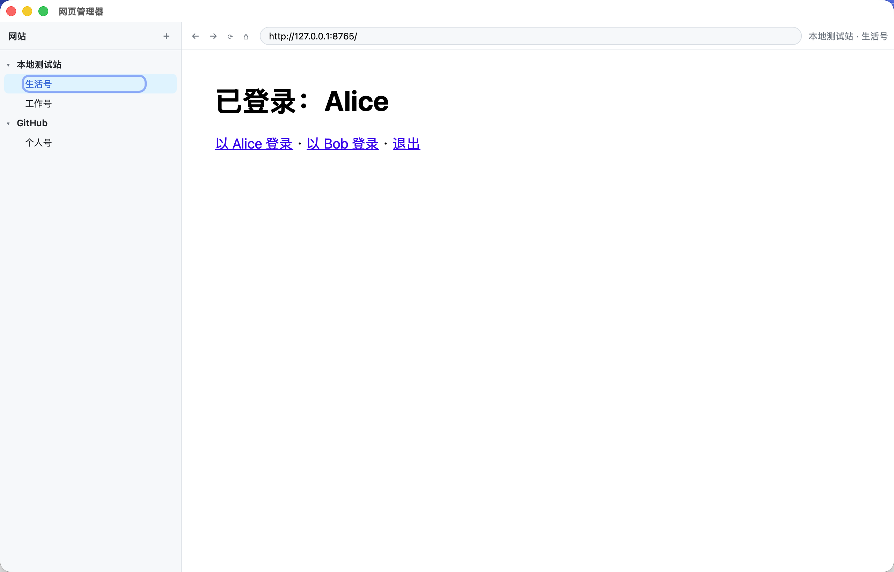
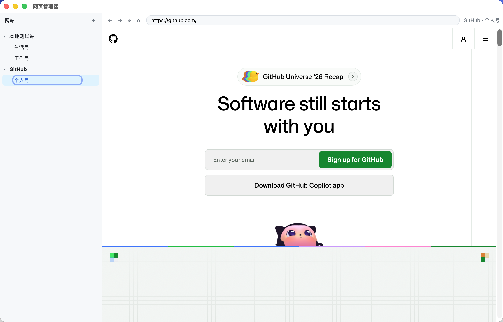

## Web Manager · 网页管理器

一个桌面端的多网站、多账号管理器（Tauri 2 + Rust + React）。左侧维护网站和账号，右侧用**每个账号独立的浏览器数据环境**打开网站——同一个网站可以同时登录两三个号，Cookie / LocalStorage / 登录态互不影响，重启后依然保留。

- 左侧栏：网站列表，每个网站下挂账号；顶部 ＋ 添加网站，网站行上的 ＋ 新增账号，✎ 编辑 / 重命名，✕ 删除
- 右侧：点击账号即打开；顶部有后退 / 前进 / 刷新 / 回首页和地址栏
- 多标签页：每个账号可以开多个标签页（＋ 新建，× 关闭），同一账号的标签页共享登录状态；网页里「新窗口打开」的链接会作为该账号的新标签页打开
- 🔑 账号密码备忘：每个账号可以记下登录用的账号、密码和备注，随时查看、一键复制。保存在**系统钥匙串**（macOS Keychain / Windows 凭据管理器 / Linux Secret Service），不写进 `sites.json`
- 删除账号（或删除网站）时一并清除该账号的浏览器数据和保存的账号密码

## 账号隔离原理

每个账号有一个固定的 UUID，对应一个独立的 WebView 数据存储：

| 平台 | 实现 | 数据位置 |
| --- | --- | --- |
| macOS 14+ | `WebviewBuilder::data_store_identifier(uuid)`（WKWebsiteDataStore） | `~/Library/WebKit/<bundle id>/WebsiteDataStore/<uuid>/` |
| Windows / Linux | `WebviewBuilder::data_directory(<app data>/profiles/<uuid>)` | 应用数据目录下的 `profiles/<uuid>/` |

网站和账号列表保存在应用数据目录的 `sites.json`（macOS 为 `~/Library/Application Support/com.mozm.webmanager/`）。

账号页面是挂在主窗口上的原生子 WebView（Tauri `unstable` 特性的 `Window::add_child`），只加载远程网站，**没有** Tauri IPC 权限（capability 只授予本地侧栏 `main` webview）。

## 环境要求

- macOS 14 Sonoma 及以上（账号隔离依赖 macOS 14 的 WKWebsiteDataStore 标识符）；Windows 10/11（WebView2）、Linux（WebKitGTK）理论支持，尚未实测
- [Rust](https://rustup.rs/) stable（开发时用的是 1.100）
- Node.js 20+ 和 pnpm 9+
- 各平台的 Tauri 系统依赖：见 <https://tauri.app/start/prerequisites/>（macOS 只需 Xcode Command Line Tools）

## 开发

```bash
pnpm install
pnpm tauri dev
```

## 打包

```bash
pnpm tauri build
```

产物在 `src-tauri/target/release/bundle/`（macOS 为 `.app` 和 `.dmg`）。未签名的 `.app` 首次打开需要在「系统设置 → 隐私与安全性」里允许。

只想要一个可运行的调试版二进制（不打安装包）：

```bash
pnpm tauri build --debug --no-bundle
./src-tauri/target/debug/web-manager
```

## 已知限制

- **macOS 13 及以下无法隔离**：`data_store_identifier` 需要 macOS 14+，低版本上所有账号会共用默认数据存储。打包配置里最低系统版本设为 14.0。
- **弹窗登录**：`target=_blank` / `window.open` 打开的页面会变成该账号的新标签页，但新标签页拿不到 `window.opener`，依赖它回传结果的 OAuth 弹窗登录（部分「用 Google / 微信登录」）可能无法完成。
- 打开的对话框会临时隐藏右侧网页（原生 WebView 总是在 HTML 界面之上）。
- 标签页只在本次运行期间存在，重启 app 后每个账号回到一个首页标签（登录状态仍保留）。打开的标签页都常驻内存，开得多会变卡。
- 账号密码只用于查看和复制，**不会自动填进网页**。
- 账号密码保存在钥匙串里，能登录这台电脑的人打开 app 就能看到，app 本身没有额外的解锁密码。
- 安装包未签名，换成新版本后第一次读取钥匙串时，macOS 可能弹窗询问是否允许访问，点「始终允许」即可。
- 暂不支持下载管理、自定义 User-Agent。
- Windows 上 WebView2 可能短暂锁住数据目录，删除失败时会记到 `pendingPurge`，下次启动再清理。

## 截图

同一网站的两个账号分别登录（本地 Cookie 测试站），互不影响：

| 生活号 → Alice | 工作号 → Bob |
| --- | --- |
|  |  |



账号密码备忘：


