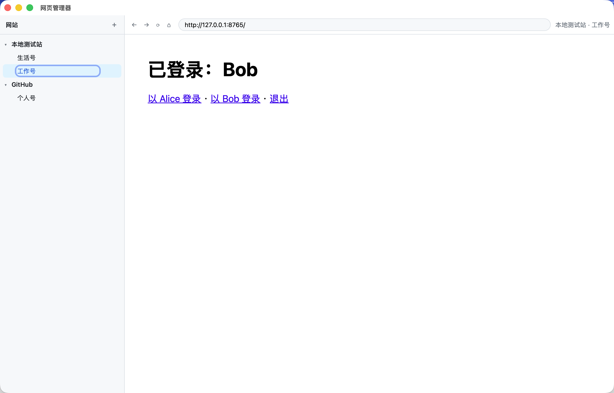
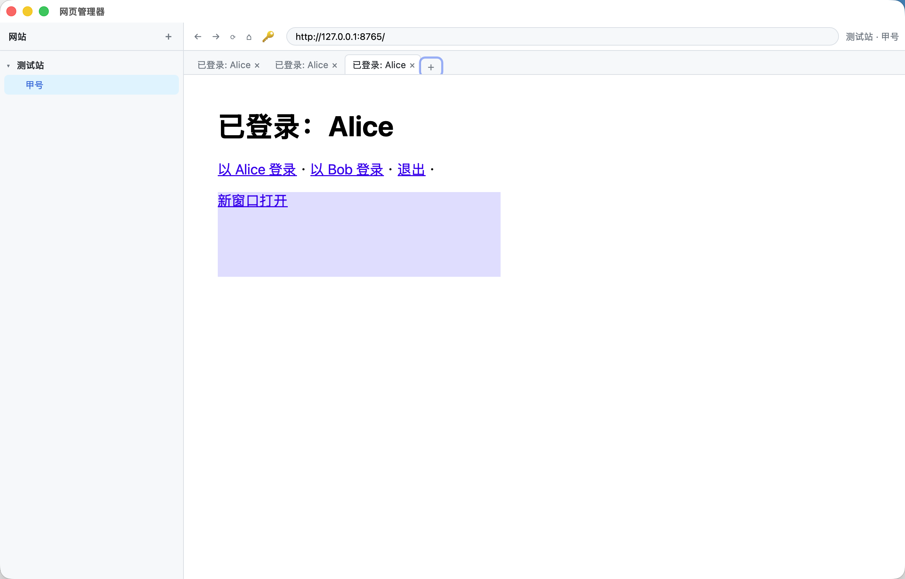
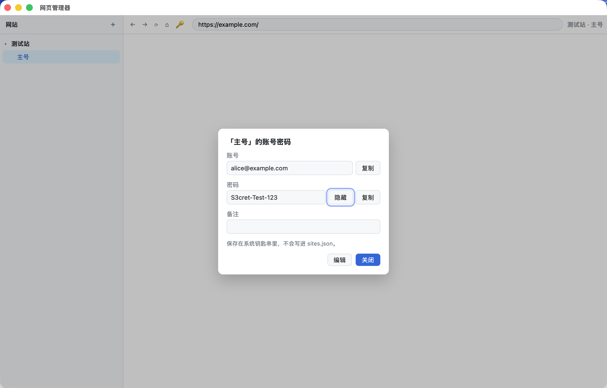

## Web Manager · 网页管理器

一个 Mac 桌面端的多网站、多账号管理器。左侧管理网站和账号，右侧用**每个账号独立的浏览器环境**打开网站：同一个网站可以同时登录好几个号，Cookie 和登录状态互不影响，切换账号不用退出重登，关掉 app 再打开也还是登录状态。



📖 **[详细使用说明（图文版）](docs/使用说明.md)**：安装、界面介绍、每个功能怎么用、更新卸载、数据位置、常见问题。

## 下载

到 [Releases](https://github.com/mozm-ctrl/web-manager/releases/latest) 页面下载：

| 电脑 | 下载哪个 | 系统要求 |
| --- | --- | --- |
| Mac（Apple 芯片和 Intel 芯片都可以） | `Web.Manager_0.8.0_universal.dmg` | macOS 14 及以上 |

> 目前只提供 Mac 版。代码本身支持 Windows，但还没有在真机上测试，暂不提供 Windows 安装包。

## 安装

### Mac
1. 双击 `.dmg`，在弹出的窗口里把 **Web Manager** 拖进「应用程序」。
2. 在访达侧栏点安装盘旁边的 ⏏ 推出安装盘（不推出的话启动台里会出现两个图标）。
3. 第一次打开时，系统会提示「无法验证开发者」或「已损坏」。这是因为安装包没有花钱做 Apple 签名，app 本身没有问题。放行方法二选一：
   - 「系统设置 → 隐私与安全性」拉到底部，点 **仍要打开**；
   - 或者在终端执行：`xattr -dr com.apple.quarantine "/Applications/Web Manager.app"`
4. 第一次保存或查看账号密码时，系统可能会问是否允许访问钥匙串，点「始终允许」。

### 更新

从 0.8.0 开始，app 每次启动会检查一次新版本（左下角「检查更新」也可以随时手动检查）。有新版本时会弹窗显示版本号和更新说明，点「立即更新」后自动下载、校验签名、安装并重启。网站、账号、登录状态和保存的密码都会保留。

0.7.x 及更早的版本没有自动更新，需要手动下载 0.8.0 的 `.dmg` 覆盖安装一次，之后就能自动更新了。

## 使用说明

下面是简要步骤，完整说明见 [docs/使用说明.md](docs/使用说明.md)。

1. **添加网站**：点左上角 ＋，填名称和网址（比如 `GitHub`、`https://github.com`）。
2. **添加账号**：鼠标移到网站那一行，点右侧的 ＋，给账号起个备注名（比如「工作号」「生活号」）。一个网站可以加任意多个账号。
3. **登录**：点左侧某个账号，右边就会打开网站，在里面正常登录一次。之后点哪个账号就是哪个号，登录状态一直保留。
4. **多标签页**：打开账号后，网页上方有标签栏，＋ 新建标签，× 关闭。同一账号的标签页共享登录状态；网页里「在新窗口打开」的链接会变成这个账号的新标签页。
5. **浏览**：顶部有后退、前进、刷新、回首页按钮和地址栏，可以直接输入网址跳转。
6. **记住账号密码**：鼠标移到账号上点 🔑（或打开网页后点工具栏上的 🔑），填写账号、密码、备注后保存。之后可以随时查看，点「显示」看密码，点「复制」粘贴到登录框。
7. **改名 / 删除**：鼠标移到网站或账号上，点 ✎ 修改，点 ✕ 删除。删除账号会同时清除它的登录数据和保存的密码。
8. **一键清除所有数据**：左侧栏最下方点「清除所有数据」，确认后会删除所有网站、账号、登录状态和保存的账号密码，app 回到刚安装时的状态。





## 主要用到的技术

| 部分 | 用了什么 | 作用 |
| --- | --- | --- |
| 应用框架 | [Tauri 2](https://tauri.app/)（Rust） | 创建窗口、把网页嵌进窗口、调用系统功能 |
| 界面 | React + TypeScript + Vite | 左侧网站/账号列表、标签栏、对话框 |
| 网页引擎 | 系统自带的 WebKit（Safari 的引擎） | 显示网页、保存 Cookie |
| 账号隔离 | `WKWebsiteDataStore` 独立数据仓库（macOS 14+） | 每个账号一份 Cookie / LocalStorage，互不干扰 |
| 密码保存 | [keyring](https://crates.io/crates/keyring)：macOS 钥匙串 | 由系统加密保存账号密码 |

因为网页引擎用的是系统自带的，安装包只有几 MB。

### 账号隔离原理

网站靠浏览器里存的 Cookie 认出「你是谁」。普通浏览器里一个网站只有一份 Cookie，所以登录第二个号会把第一个顶掉。这个 app 给每个账号分配一个固定编号（UUID），再用这个编号向系统网页引擎申请一个独立的数据仓库。每个账号的网页只能读写自己的仓库，所以对网站来说，就像是几台不同电脑上的浏览器。

### 数据存在哪里

所有数据只在本机，不会上传：

| 内容 | 位置 |
| --- | --- |
| 网站和账号列表（不含密码） | `~/Library/Application Support/com.mozm.webmanager/sites.json` |
| 每个账号的 Cookie 和网页缓存 | `~/Library/WebKit/com.mozm.webmanager/` |
| 保存的账号密码 | 钥匙串（搜索 `com.mozm.webmanager`） |

直接删除 app 不会删除这些数据。想彻底清理，先在 app 左下角点「清除所有数据」，再把 app 删掉即可。

## 已知限制

- 只隔离登录状态，**不隔离 IP 和设备特征**。风控严格的平台（电商、社交媒体等）仍可能识别出多个账号属于同一个人。
- Mac 需要 macOS 14 及以上，更低版本无法隔离账号。
- 依赖弹窗回传结果的第三方登录（部分「用 Google / 微信登录」）可能无法完成，可以改用账号密码登录。
- 标签页不会在重启后恢复（登录状态会保留）；打开的标签页都常驻内存，开很多会变卡。
- 账号密码只能查看和复制，不会自动填写；查看前不需要额外验证。
- 打开对话框时右侧网页会暂时隐藏。
- 安装包未签名，首次打开需要手动放行（自动更新下载的新版本不需要再放行）。

## 从源码构建

需要 [Rust](https://rustup.rs/)、Node.js 20+、pnpm 9+，以及 [Tauri 的系统依赖](https://tauri.app/start/prerequisites/)（Mac 只需 Xcode Command Line Tools）。

```bash
pnpm install
pnpm tauri dev      # 开发模式运行
pnpm tauri build    # 打包当前平台的安装包
```

Mac 通用包（Intel + Apple 芯片）：

```bash
rustup target add x86_64-apple-darwin aarch64-apple-darwin
pnpm tauri build --target universal-apple-darwin
```

代码也能在 Mac 上交叉编译 Windows 版（未在真机测试，不随 Release 发布）：需要 `cargo install cargo-xwin`，以及 PATH 里有 `clang-cl`、`lld-link`、`llvm-lib`、`llvm-rc`。

```bash
rustup target add x86_64-pc-windows-msvc
pnpm tauri build --runner cargo-xwin --target x86_64-pc-windows-msvc --no-bundle
```

### 发布新版本（带自动更新）

> ⚠️ **不要修改 `tauri.conf.json` 里的 `identifier`（`com.mozm.webmanager`）。** 网站和账号列表（`~/Library/Application Support/com.mozm.webmanager/sites.json`）、每个账号的登录数据（`~/Library/WebKit/com.mozm.webmanager/`）和钥匙串里的密码都按这个标识存放，改了之后新版本会读不到用户原来的数据，看起来就像全部丢失。
>
> 同样不要更换 `plugins.updater.pubkey`：已安装的 app 只接受用对应私钥签名的更新包，换了公钥（或丢了私钥）之后，老用户就收不到自动更新，只能手动下载安装。

1. 把 `package.json`、`src-tauri/Cargo.toml`、`src-tauri/tauri.conf.json` 里的版本号改成新版本（必须比已发布的大）。
2. 运行 `scripts/release-mac.sh "这次的更新说明"`。它会打包通用版，用 `~/.tauri/web-manager.key` 签名（私钥密码从钥匙串条目 `web-manager-updater-key` 读取），并在 `release/v版本号/` 生成 4 个文件：`.dmg`、`.app.tar.gz`、`.app.tar.gz.sig`、`latest.json`。
3. 在 GitHub 新建 Release，标签 `v版本号`，把这 4 个文件全部上传，直接发布（不要选草稿或预发布）。已安装的 app 检查的是 `releases/latest/download/latest.json`，也就是最新正式 Release 里的 `latest.json`。

签名私钥和密码只保存在发布用的电脑上，不在仓库里；丢了就无法再发布自动更新，务必备份到密码管理器。

`ci/release.yml` 是 GitHub Actions 工作流，可以在 GitHub 的 Mac 机器上打包并挂到 Release。启用方法：把它复制到 `.github/workflows/release.yml`，并在仓库 Secrets 里添加 `TAURI_SIGNING_PRIVATE_KEY`（私钥文件内容）和 `TAURI_SIGNING_PRIVATE_KEY_PASSWORD`，然后在 Actions 页面手动运行或推送 `v*` 标签。（目前本机的 GitHub 令牌没有 `workflow` 权限，所以还没有启用，发布走上面的本机脚本。）

### 代码结构

| 文件 | 内容 |
| --- | --- |
| `src-tauri/src/lib.rs` | 后端：账号 WebView、标签页、账号隔离、删除清理 |
| `src-tauri/src/store.rs` | 网站和账号列表的读写（`sites.json`） |
| `src-tauri/src/credentials.rs` | 账号密码读写系统钥匙串 |
| `src/App.tsx`、`src/App.css` | 界面 |
| `src/api.ts` | 界面调用后端的接口 |
| `scripts/release-mac.sh` | 本机打包发布（含自动更新文件） |
