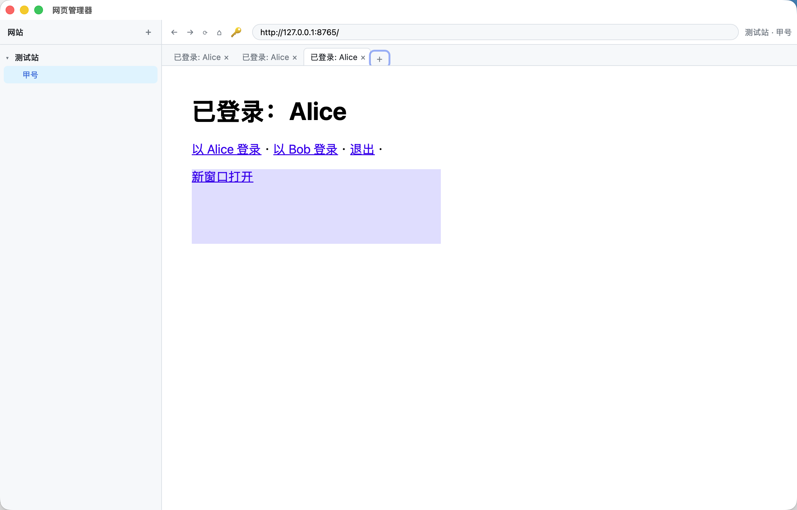
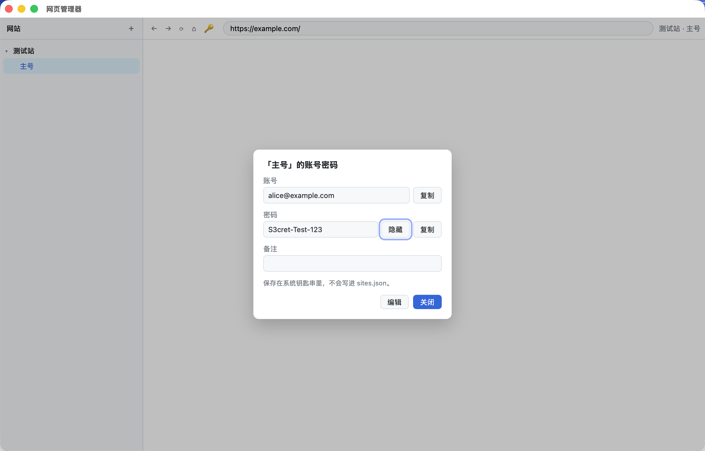

## Web Manager 详细使用说明

适用版本：v0.8.0 及以上。下载地址：<https://github.com/mozm-ctrl/web-manager/releases/latest>

### 目录

1. [这个软件能做什么](#1-这个软件能做什么)
2. [下载与安装](#2-下载与安装)
3. [认识界面](#3-认识界面)
4. [五分钟上手](#4-五分钟上手)
5. [功能详解](#5-功能详解)
6. [常见使用场景](#6-常见使用场景)
7. [更新与卸载](#7-更新与卸载)
8. [数据存在哪里、安全吗](#8-数据存在哪里安全吗)
9. [常见问题](#9-常见问题)
10. [已知限制](#10-已知限制)

---

## 1. 这个软件能做什么

普通浏览器里，一个网站只能同时登录一个账号：登录第二个号，第一个就被挤掉了。

Web Manager 给**每个账号一个独立的浏览器环境**，所以你可以：

- 在同一个网站同时登录多个账号（比如两个 GitHub、三个邮箱），点一下就切换，不用退出重登；
- 关掉软件再打开，每个账号仍是登录状态；
- 给每个账号记下账号、密码和备注，忘了随时查看、一键复制；
- 每个账号可以开多个标签页。

它是一个 Mac 桌面软件（不是小程序），所有数据只保存在你自己的电脑上。目前只提供 Mac 版。

---

## 2. 下载与安装

### 2.1 选择安装包

打开 [下载页](https://github.com/mozm-ctrl/web-manager/releases/latest)，在页面下方的 **Assets** 里下载：

| 你的电脑 | 下载哪个文件 | 系统要求 |
| --- | --- | --- |
| Mac（Apple 芯片 M1/M2/M3… 和 Intel 芯片都可以） | `Web.Manager_x.x.x_universal.dmg` | macOS 14 Sonoma 及以上 |

> 查看 Mac 系统版本：左上角  →「关于本机」。低于 macOS 14 的 Mac 也能打开软件，但**账号之间不会隔离**，不建议使用。

### 2.2 Mac 安装步骤

1. 双击下载好的 `.dmg` 文件，会弹出一个窗口。
2. 把窗口里的 **Web Manager** 图标拖到旁边的「应用程序」文件夹。
3. 打开「访达」，在左侧栏找到「Web Manager」安装盘，点它旁边的 ⏏ 推出。
   - 不推出的话，启动台里会出现两个 Web Manager 图标。
4. 在「启动台」或「应用程序」里打开 Web Manager。

**第一次打开被拦截怎么办？**

系统可能提示「无法验证开发者」或「已损坏，无法打开」。这是因为安装包没有付费做 Apple 签名，软件本身没有问题。二选一放行：

- **方法一**：打开「系统设置 → 隐私与安全性」，拉到最下面，看到 Web Manager 相关提示，点 **仍要打开**，输入电脑密码确认。
- **方法二**：打开「终端」，粘贴下面这行并回车：

  ```bash
  xattr -dr com.apple.quarantine "/Applications/Web Manager.app"
  ```

放行一次后，以后就能正常打开了。

**钥匙串授权弹窗**：第一次保存或查看账号密码时，系统可能问「Web Manager 想要使用钥匙串中的机密信息」，输入电脑密码并点 **始终允许**。打开 🔑 窗口时直接显示账号，密码显示为圆点，不会弹窗；点「显示」「复制密码」或「编辑」时才会读取钥匙串。从 0.9.0 开始，所有账号的密码存在钥匙串的同一个条目里：**每次打开软件最多问一次**，输入一次后，所有账号的查看、复制、编辑、👁 小窗都不会再问，退出软件后再打开才可能再问。

---

## 3. 认识界面



```
┌──────────────┬────────────────────────────────────────────┐
│ ● ● ●        │                网站 · 账号                   │  ← 顶部栏
│ 网站       ＋ │ ▯ ← → ⟳ ⌂ 🔑 [ 地址栏                     ] ☾ │  ← 工具栏
│              ├────────────────────────────────────────────┤
│ ▾ GitHub     │ [标签1 ×] [标签2 ×] ＋                       │  ← 标签栏
│     工作号    ├────────────────────────────────────────────┤
│     生活号    │                                            │
│ ▾ 邮箱        │              网页内容                       │
│     主号      │                                            │
│              │                                            │
├──────────────┤                                            │
│ 检查更新 v0.8 │                                            │
└──────────────┴────────────────────────────────────────────┘
   左侧栏                         右侧
```

**顶部栏**

| 位置 | 作用 |
| --- | --- |
| 正中间文字 | 当前是哪个网站、哪个账号；加载中会显示「加载中」 |
| 空白处 | 按住拖动可移动窗口，双击可最大化 |

**左侧栏**

| 位置 | 按钮 | 作用 |
| --- | --- | --- |
| 顶部 | ＋ | 添加网站 |
| 网站那一行（鼠标移上去才显示） | ＋ | 给这个网站添加账号 |
| | ✎ | 修改网站名称、网址 |
| | ✕ | 删除网站（连同下面所有账号） |
| | 点网站名或 ⌄ / › | 展开 / 收起账号列表（点整行任意位置都可以） |
| 账号那一行（鼠标移上去才显示） | 🔑 | 查看 / 保存这个账号的账号密码 |
| | ✎ | 修改账号备注名 |
| | ✕ | 删除账号 |
| 最底部 | 检查更新 | 检查有没有新版本，旁边是当前版本号 |
| 侧栏和右侧之间的分隔条 | 拖动 | 调整侧栏宽度（双击恢复默认，宽度会被记住） |

**右侧工具栏**（打开账号后出现）

| 按钮 | 作用 |
| --- | --- |
| ▯（最左边） | 收起 / 展开左侧栏，收起后网页占满整个窗口（状态会被记住） |
| ← / → | 后退 / 前进 |
| ⟳ / ✕ | 刷新；网页加载中时变成 ✕，点它停止加载 |
| ⌂ | 回到这个账号的首页（账号密码里填的「地址」，没填则是添加网站时填的网址） |
| 🔑 | 查看当前账号保存的账号密码 |
| 地址栏 | 显示当前网址；输入新网址后按回车跳转 |
| ☾ / ☀（最右边） | 切换夜间 / 白天模式（会被记住） |

---

## 4. 五分钟上手

以「同时登录两个 GitHub 账号」为例：

1. **添加网站**：点左上角 ＋，名称填 `GitHub`，网址填 `github.com`，点「确定」。
2. **添加第一个账号**：鼠标移到左侧「GitHub」那一行，点右侧出现的 ＋，备注名填 `工作号`，点「确定」。
3. **再添加一个账号**：同样操作，备注名填 `生活号`。
4. **登录第一个号**：点左侧「工作号」，右侧打开 GitHub，正常登录你的工作账号。
5. **登录第二个号**：点左侧「生活号」，右侧打开的是一个全新的 GitHub（未登录），登录你的另一个账号。
6. **切换**：之后点「工作号」就是工作账号，点「生活号」就是生活账号，互不影响。
7. **（可选）记住密码**：鼠标移到「工作号」上点 🔑，填写账号和密码，点「保存」。

关掉软件再打开，点任意账号，仍然是登录状态。

---

## 5. 功能详解

### 5.1 网站

**添加网站**

- 点左侧栏顶部的 ＋。
- **名称**：可以留空，留空时自动用网址的域名（比如 `github.com`）。
- **网址**：必填。可以不写 `https://`，软件会自动补上。只支持 `http://` 和 `https://` 开头的网址。
- 同一个网站可以重复添加多次（比如分成「GitHub-公司」「GitHub-个人」两组）。

**修改网站**

- 鼠标移到网站行，点 ✎，可以改名称和网址。
- 改网址只影响以后点 ⌂ 回首页、以及新开标签页时打开的地址，**不影响已有的登录状态**。

**删除网站**

- 鼠标移到网站行，点 ✕，确认后删除。
- ⚠️ 会同时删除这个网站下的**所有账号**，以及它们的登录状态和保存的账号密码，无法恢复。

### 5.2 账号

**添加账号**

- 鼠标移到网站行，点 ＋。
- **备注名**：只是给你自己看的名字（如「工作号」「小号 2」），可以留空，留空时自动命名为「账号 1」「账号 2」……
- 一个网站可以添加任意多个账号，没有数量上限。

**登录**

- 点左侧的账号，右侧打开网站首页。在网页里像平时一样登录就行（输入账号密码、扫码、验证码都可以）。
- 登录状态会自动保存，**不需要**在软件里填写密码也能保持登录。

**切换账号**

- 直接点左侧另一个账号。之前那个账号的页面会在后台保留，切回来时还在原来的位置。

**重命名账号**

- 鼠标移到账号行，点 ✎，修改备注名。不影响登录状态。

**删除账号**

- 鼠标移到账号行，点 ✕，确认后删除。
- 会同时删除这个账号的登录状态、Cookie、网页缓存和保存的账号密码，无法恢复。

### 5.3 标签页

- 打开账号后，网页上方是标签栏。标签左侧出现转圈图标，表示这个网页正在加载。
- 点 ＋ 新建标签页，会打开这个账号的首页；同时光标停在地址栏、网址已全选，想去别的网址直接粘贴按回车即可。
- 点标签切换，点标签上的 × 关闭。关闭最后一个标签后，右侧回到空白页，再点左侧账号会重新打开。
- **同一个账号的所有标签页共享登录状态**：在一个标签里登录，其他标签也是登录状态。
- 网页里「在新窗口打开」的链接，会自动变成这个账号的一个新标签页。
- 每个账号有自己的一组标签页，切换账号时各自保留。
- 注意：标签页**不会在重启后恢复**，重启后每个账号只打开一个首页标签（登录状态不受影响）。

### 5.4 浏览

- **后退 / 前进 / 刷新**：和普通浏览器一样。
- **回首页 ⌂**：回到添加网站时填的网址。
- **地址栏**：点进去输入网址，按回车跳转。可以跳到别的网站，用的仍是当前账号的环境。

### 5.5 账号密码备忘（🔑）

用来记下每个账号的登录信息，免得忘记。

**打开方式**（两种都可以）

- 鼠标移到左侧账号行，点 🔑；
- 打开账号后，点工具栏上的 🔑。

**第一次保存**

1. 弹窗里填写：
   - **账号**：用户名、邮箱或手机号；
   - **密码**；
   - **地址**（可选）：默认是这个网站的网址。改成别的网址（比如百度）后，以后打开这个账号、新建标签页、点 ⌂ 都会进入这个网址；清空则恢复为网站的网址。
2. 点「保存」，窗口自动关闭。

**查看与复制**

- 再次点 🔑，账号和备注直接显示，**密码默认隐藏**。
- 点密码旁的「显示」查看密码，再点「隐藏」收起。
- 点「复制」把账号或密码复制到剪贴板，然后到网页登录框里按 ⌘V 粘贴。

**👁 小窗复制**

- 鼠标移到左侧账号行，点 🔑 左边的 👁，会弹出一个小窗口，显示这个账号的「账号」和「密码」，每一项后面都有「复制」按钮；密码默认显示为圆点，点「显示」可以查看。
- 小窗口一直浮在最上面，可以拖到网页登录框旁边：点小窗的「复制」，再到登录框里按 ⌘V 粘贴，不用来回开关窗口。
- 用完点小窗左上角的关闭按钮关掉；再点一次 👁 会把已经打开的小窗拿到最前面。不同账号可以同时各开一个小窗。

**修改与删除**

- 点「编辑」修改，改完点「保存」，窗口自动关闭。
- 想删掉保存的信息：点「编辑」，把账号、密码全部清空，再点「保存」。

**说明**

- 密码保存在 Mac 系统自带的加密密码库「钥匙串」里，不会写进软件的数据文件，也不会上传。
- 这里只负责**记录和复制**，不会自动帮你填进网页。
- 查看密码前不需要额外验证，能登录这台电脑的人都能看到，请注意电脑本身的锁屏密码。



### 5.6 下载文件

- 在网页里点下载链接（附件、导出报表、「下载」按钮等），文件会**直接保存到「下载」文件夹**（`~/Downloads`），不会弹出询问框。
- 已有同名文件时自动改名为 `文件名 (1).扩展名`、`文件名 (2).扩展名`……**不会覆盖**原来的文件。
- 下载用的是当前账号的登录状态，需要登录才能下载的文件也能下载。
- 工具栏右侧一直有一个 ⬇ 按钮（没有下载时点开是空列表）：
  - 正在下载时按钮转圈；
  - 下载完成后按钮右上角出现小红点，窗口顶部标题会短暂显示「已下载 文件名」（失败时显示「下载失败：文件名」）；
  - 点 ⬇ 打开下载列表（红点随之消失），每一行显示文件名、来自哪个「网站 · 账号」，以及「下载中 / 完成 / 下载失败」。
- 在列表里：
  - 点**文件名**，用默认程序打开文件；
  - 点 🔍，在访达中选中这个文件；
  - 文件已经被移走或删除时，这一行会提示「文件已被移动或删除」；
  - 点「清除记录」只清空列表，**不会删除已下载的文件**；
  - 按 Esc 或点列表外面的空白处关闭列表。
- 列表只保留最近 50 条，退出软件后清空。

---

## 6. 常见使用场景

| 场景 | 建议做法 |
| --- | --- |
| 工作号和个人号分开 | 同一个网站加两个账号，备注名写「工作」「个人」 |
| 管理多个店铺 / 多个公众号后台 | 每个后台网址加一个网站，每个店铺一个账号；用 🔑 备注写清楚店铺名、绑定手机 |
| 多个邮箱 | 网站填邮箱网址，每个邮箱一个账号，用 🔑 记下邮箱地址和密码 |
| 帮家人 / 同事临时登录 | 新建一个账号，用完直接删除该账号，登录痕迹一并清掉 |
| 测试网站的不同角色 | 管理员、普通用户各一个账号，同时打开对比 |

> ⚠️ 本软件只隔离登录状态，**不更换 IP、不伪装设备**。电商、社交媒体等风控严格的平台，仍可能识别出多个账号在同一台电脑上使用。请遵守各平台的使用规则。

---

## 7. 更新与卸载

### 7.1 更新到新版本

从 v0.8.0 开始支持自动更新：

- 每次打开 app 会自动检查一次；app 一直开着时，每 4 小时再检查一次（电脑睡眠后醒来也会补上）。有新版本时弹出提示，显示新版本号和更新说明。点「立即更新」，app 会下载并校验新版本，安装后自动重启；点「以后再说」则这次运行期间不再提醒同一个版本，下次打开 app 时再提醒。
- 正在用其他对话框（比如查看账号密码）时不会弹出更新提示，关掉对话框后过一会儿（10 分钟内）再提醒。
- 只要发现了新版本（包括点了「以后再说」的），左下角版本号的右上角就会显示一个小红点，更新后消失。
- 也可以随时点左侧栏底部的「检查更新」手动检查，旁边显示的是当前版本号。点了之后会显示转圈和「正在检查…」，检查完弹出结果。有新版本时旁边版本号的右上角会有小红点。

如果你用的是 v0.7.8 或更早的版本，需要手动更新一次：到下载页下载新的 `.dmg`，同样拖进「应用程序」，选择「替换」，然后推出安装盘。之后的版本就会自动更新了。

更新后，原来的网站、账号、登录状态和保存的密码**都会保留**。Mac 上更新后第一次查看密码，可能会再弹一次钥匙串授权，点「始终允许」即可。更新到 0.9.0 后第一次查看密码时，软件会把各账号原来分开保存的密码合并到一个钥匙串条目里，这一次可能会连着问几次（每个以前保存过密码的账号一次），合并完以后每次打开软件最多只问一次。

### 7.2 完全卸载

只删除软件本身，数据会留在电脑上（重新安装后还能用）。想彻底删干净：

1. 打开软件，把左侧的网站逐个删除（鼠标移到网站上点 ✕），账号的登录数据和保存的密码会一起删除；
2. 退出软件；
3. 把「应用程序」里的 Web Manager 拖进废纸篓。

如果软件已经删掉、没法先清除数据，可以手动删除第 8 节表格里列出的文件夹。

---

## 8. 数据存在哪里、安全吗

所有数据只保存在你自己的电脑上，**不会上传到任何服务器**，别人安装的软件里看不到你的数据。

| 内容 | 位置 |
| --- | --- |
| 网站和账号列表（只有名称、网址，**不含密码**） | `~/Library/Application Support/com.mozm.webmanager/sites.json` |
| 每个账号的登录状态、Cookie、网页缓存 | `~/Library/WebKit/com.mozm.webmanager/` |
| 临时缓存 | `~/Library/Caches/com.mozm.webmanager/` |
| 用 🔑 保存的账号密码 | 「钥匙串访问」里搜索 `com.mozm.webmanager` |
| 网页里下载的文件 | 「下载」文件夹 `~/Downloads` |

> Mac 上 `~/Library` 默认隐藏：在访达按 ⌘⇧G，粘贴路径即可打开。

**安全方面**

- 你打开的网页**读不到**你保存的密码，也调用不了软件的功能。
- 网页缓存会随使用越来越大，和普通浏览器一样，可以通过删除账号释放空间。
- 软件代码完全公开在本仓库，可以自行检查。

---

## 9. 常见问题

**Q：为什么第一次打开会被系统拦截？安全吗？**
A：因为安装包没有付费购买苹果 / 微软的签名证书，系统不认识它。只要是从本仓库的下载页下载的，就可以放心放行，放行方法见第 2 节。

**Q：一个网站最多能加几个账号？**
A：没有上限。但每个打开过的账号和标签页都会占用内存，同时开十几个以上可能变卡，用完可以关闭标签页。

**Q：重启软件后要重新登录吗？**
A：不用，登录状态会保留。但网站自己设定的登录有效期过了（比如有的网站 7 天要重新登录），还是需要重新登录，这和普通浏览器一样。

**Q：点「用微信登录」「用 Google 登录」没反应 / 登录不上？**
A：部分依赖弹窗的第三方登录方式目前可能无法完成。建议改用账号密码、手机验证码或扫码登录。

**Q：打开弹窗（比如添加账号）时，右侧网页消失了？**
A：正常现象，弹窗关闭后网页会恢复，内容不会丢。

**Q：能把账号搬到另一台电脑上用吗？**
A：目前不行，每台电脑的数据各自独立。换电脑需要重新添加网站和账号并登录一次。

**Q：会自动帮我填密码吗？**
A：不会。🔑 只用来记录和复制，复制后手动粘贴到登录框。

**Q：删除了账号还能找回吗？**
A：不能。删除账号会同时清除它的登录状态和保存的密码。

**Q：电脑是 macOS 13 或更早，能用吗？**
A：能打开，但账号之间不隔离（所有账号共用一份登录状态），失去了这个软件的主要作用，建议升级系统。

**Q：遇到其他问题怎么办？**
A：到 [Issues](https://github.com/mozm-ctrl/web-manager/issues) 提交问题，最好附上系统版本和截图。

---

## 10. 已知限制

- 目前只提供 Mac 版。
- 只隔离登录状态，不隔离 IP 和设备特征。
- 部分依赖弹窗的第三方登录可能无法完成。
- 标签页不会在重启后恢复；打开很多标签页会占用较多内存。
- 账号密码不会自动填写，查看前也不需要额外验证。
- 下载不显示进度百分比，也不能暂停或取消；不能选择保存位置（固定存到「下载」文件夹）；下载列表退出软件后清空。
- 安装包未签名，首次打开需要手动放行。
- 自动更新需要能访问 GitHub；访问不了时「检查更新」会提示失败，可以到下载页手动下载。
